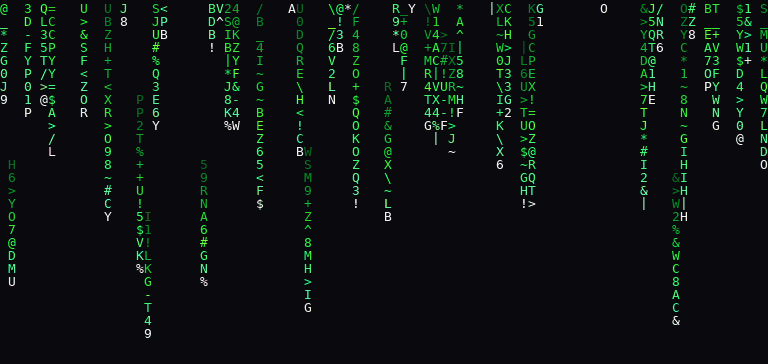
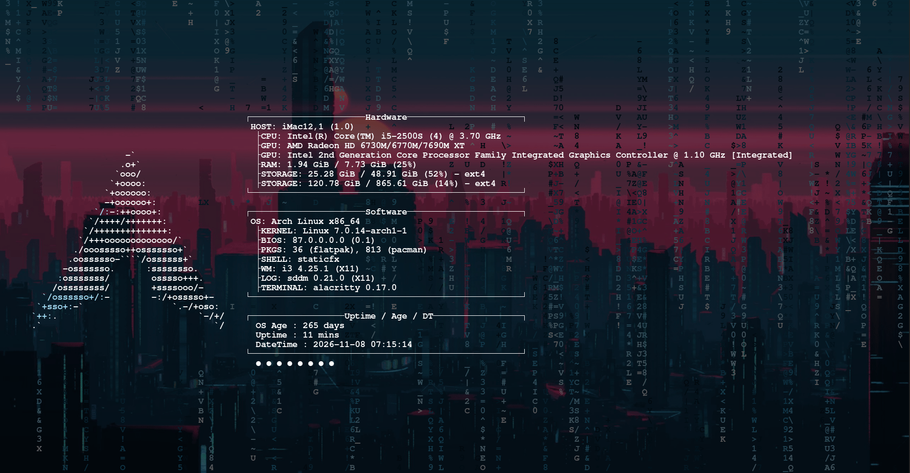
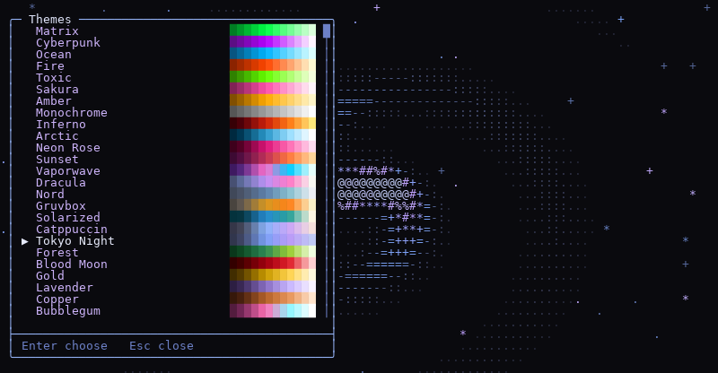
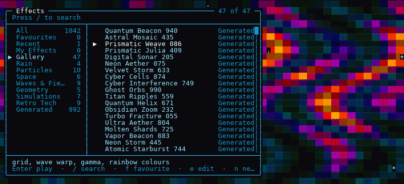
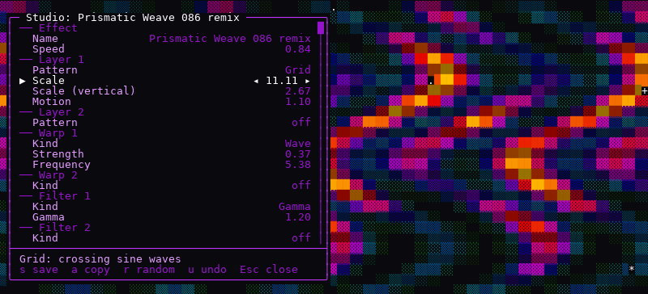
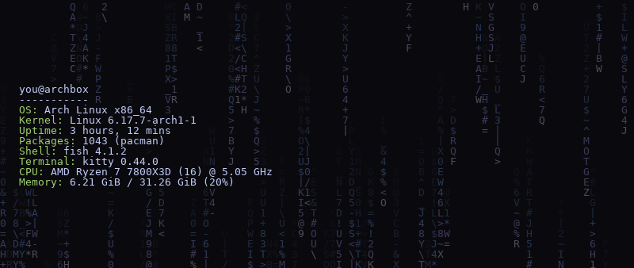

# StaticFX

[](https://pypi.org/project/staticfx/)
[](https://pypi.org/project/staticfx/)
[](https://github.com/ethanlabs101/StaticFX/actions/workflows/ci.yml)
[](https://github.com/ethanlabs101/StaticFX/blob/main/LICENSE)

Animated ASCII effects for your terminal. Think `cmatrix`, but with a
thousand more effects, live theme switching, and a studio for making your own.



Pure Python, no dependencies, runs in any modern terminal on Linux, macOS,
WSL, and even Android through Termux.

## Install

You need Python 3.10 or newer (`python3 --version` tells you).

```bash
pipx install staticfx
staticfx
```

[pipx](https://pipx.pypa.io) installs command-line tools in their own
environment so they can't clash with anything else. If you don't have it:

Your system | Get pipx with
--- | ---
macOS with Homebrew | `brew install pipx`
macOS without Homebrew | `python3 -m pip install --user pipx`
Ubuntu, Debian | `sudo apt install pipx`
Fedora | `sudo dnf install pipx`
Arch | `sudo pacman -S python-pipx`
Windows (WSL) | same as your Linux distro
Android (Termux) | not needed: `pkg install python`, then `pip install staticfx`

Then run `pipx ensurepath` once (or `python3 -m pipx ensurepath` if the
`pipx` command isn't found yet) and open a new terminal so the `staticfx`
command is on your PATH.

Plain `pip install staticfx` works too, inside a virtual environment.
On Termux, if the katakana in Matrix rain show up as boxes, run
`staticfx --ascii`, and turn the phone sideways if it says the terminal is
too small. Newer
Ubuntu and Debian refuse to pip-install outside one, which is another reason
to use pipx. To try it without installing anything:

```bash
git clone https://github.com/ethanlabs101/StaticFX
cd StaticFX
python3 -m staticfx
```

## The 30-second tour

Key | Does
--- | ---
`←` `→` | Previous / next effect
`m` | Browse and search every effect, with live preview
`t` | Change the colour theme
`l` | Looks: effect + theme + filters, saved under a name
`n` | Make your own effect in the Studio
`f` | Favourite
`a` | Auto-cycle (screensaver mode)
`y` | Your system info (fastfetch/neofetch) over the live effect
`?` | Every key
`q` | Quit

Everything is remappable in Settings (`o`). The full guide is in
[docs/USAGE.md](https://github.com/ethanlabs101/StaticFX/blob/main/docs/USAGE.md).

## Fetch Demo

StaticFX has a feature which displays your fetch tool info with the current
active animation/theme displayed behind your fetch info. ***(Supports Neofetch/Fastfetch)***



> Demo recorded from my 2011 iMac.

## What's inside

There are 50 hand-written effects in seven groups. Rain: the classic, plus
binary, hex and glitch versions. Particles: snow, embers, fireworks, orbits.
Space: a starfield, a galaxy, a black hole, a wormhole. Waves and fields:
plasma, aurora, a lava lamp, a synthwave grid. Geometry: a tumbling cube, a 4D
tesseract, spirographs. Simulations: Game of Life, Langton's ant, fire, a maze
that carves itself. Retro tech: boot screens, decryption, circuits, TV static.

On top of those are 992 generated effects. Each one is a recipe of layered
patterns (spirals, Julia and Mandelbrot fractals, Voronoi cells, metaballs,
noise), warps (kaleidoscope, swirl, tile, fold) and filters. They're seeded,
so `proc_042` is the same effect for everyone, forever. An automated quality
check weeds out the duds, and 47 hand-picked ones live in the Gallery.

Then there are your own. The Studio remixes any generated effect or starts
from scratch, with a live preview and undo, and saves small JSON files you
can share.

You also get:

- **26 colour themes**: originals like Matrix, Inferno and Vaporwave, takes on
  popular editor schemes (Dracula, Nord, Gruvbox, Catppuccin, Tokyo Night), an
  animated rainbow, and Strobe if you opt in (it's off by default for
  photosensitivity reasons)
- filters that work on anything: CRT scanlines, glitch, rainbow recolour
- looks, which save an effect with its theme, speed and filters so you can
  recall it with one key (a dozen come built in)





## Make your own

Press `n` for a new effect, or highlight a generated one in the browser and
press `e` to remix it. Arrow keys change things; `s` saves it to
**My Effects**.



See [docs/STUDIO.md](https://github.com/ethanlabs101/StaticFX/blob/main/docs/STUDIO.md) for what every control does, and
[docs/EFFECT_FORMAT.md](https://github.com/ethanlabs101/StaticFX/blob/main/docs/EFFECT_FORMAT.md) for the file format if you'd
rather write recipes by hand.

## Command line

```bash
staticfx -e plasma -t ocean           # start on an effect and theme
staticfx --look "Synthwave"           # start from a look
staticfx --auto 30 --duration 600     # screensaver: new effect every 30s, quit after 10 min
staticfx list fire                    # search effects
staticfx render galaxy --size 80x24   # print one frame (add --ansi for colour)
staticfx stream plasma --size 120x40 # frames for other programs (NeoWave uses this)
staticfx fetch                        # your fastfetch/neofetch info over a live effect
staticfx fetch --once                 # one still frame, for your .bashrc
staticfx new "Night Drive"            # create a random effect in My Effects
staticfx export my_night_drive nd.sfx # share it
staticfx doctor                       # check your setup
```



`staticfx --help` and `staticfx COMMAND --help` list everything.

## NeoWave integration (new in 2.1.0)

StaticFX 2.1.0 adds `staticfx stream`, a frame feed for programs built to read
it. Its first user is [NeoWave](https://github.com/ethanlabs101/neowave-lua),
my fastfetch/neofetch editor, which runs any StaticFX effect, theme or look as
a live background and can export your fetch as a GIF over an effect.

https://github.com/user-attachments/assets/7869f462-5cf7-48dd-83de-5dee0ff40fd7

> StaticFX/NeoWave Lua Integration Demo

<details>
<summary>View NeoWave Lua Sneek Peak</summary>


> NeoWave Lua can create beautiful unique custom fetch configs.

</details>

Install StaticFX 2.1.0 or newer and turn it on in NeoWave under
**Settings → Animated background**. If you want to support it in your own
program, the format is in [docs/STREAM.md](docs/STREAM.md).

## Docs

- [Usage](https://github.com/ethanlabs101/StaticFX/blob/main/docs/USAGE.md): every key, the browser, themes, looks, settings,
  command line, troubleshooting
- [The Studio](https://github.com/ethanlabs101/StaticFX/blob/main/docs/STUDIO.md)
- [Effect file format](https://github.com/ethanlabs101/StaticFX/blob/main/docs/EFFECT_FORMAT.md)
- [Writing a built-in effect](https://github.com/ethanlabs101/StaticFX/blob/main/docs/WRITING_EFFECTS.md) in Python
- [Architecture](https://github.com/ethanlabs101/StaticFX/blob/main/docs/ARCHITECTURE.md): how it fits together, and why
- [Releasing](https://github.com/ethanlabs101/StaticFX/blob/main/docs/RELEASING.md): publishing a new version to PyPI

## Development

```bash
git clone https://github.com/ethanlabs101/StaticFX && cd StaticFX
python3 -m pip install -e '.[dev]'
python3 -m pytest          # ~650 tests, about a minute
ruff check . && ruff format --check . && mypy
```

See [CONTRIBUTING.md](https://github.com/ethanlabs101/StaticFX/blob/main/CONTRIBUTING.md) for how changes are made and checked.

## License

[MIT](https://github.com/ethanlabs101/StaticFX/blob/main/LICENSE)

## Enjoying StaticFX?

Try [TermiCube](https://github.com/ethanlabs101/TermiCube) 
> A dependency-free 3D Rubik's Cube animation for the terminal.
